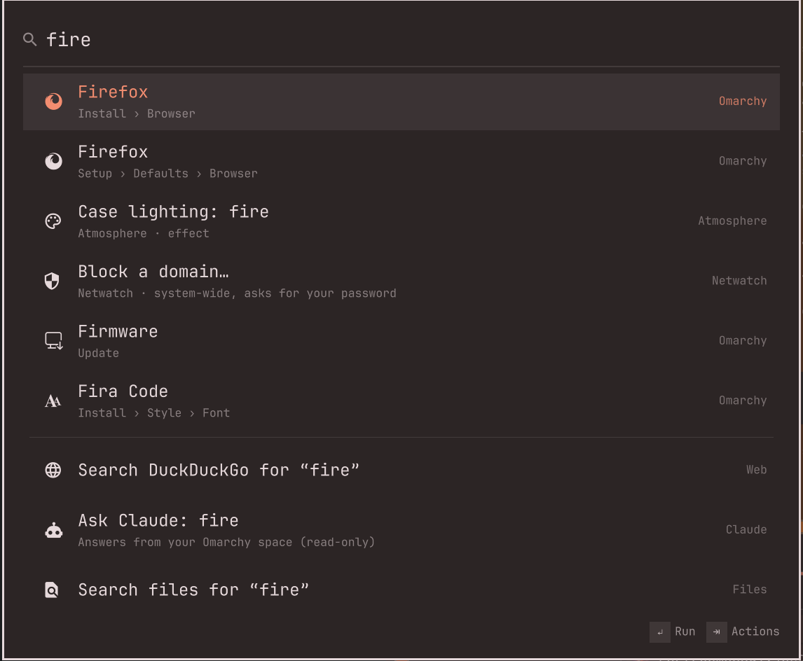

# Launcher

```
██╗      █████╗ ██╗   ██╗███╗   ██╗ ██████╗██╗  ██╗███████╗██████╗
██║     ██╔══██╗██║   ██║████╗  ██║██╔════╝██║  ██║██╔════╝██╔══██╗
██║     ███████║██║   ██║██╔██╗ ██║██║     ███████║█████╗  ██████╔╝
██║     ██╔══██║██║   ██║██║╚██╗██║██║     ██╔══██║██╔══╝  ██╔══██╗
███████╗██║  ██║╚██████╔╝██║ ╚████║╚██████╗██║  ██║███████╗██║  ██║
╚══════╝╚═╝  ╚═╝ ╚═════╝ ╚═╝  ╚═══╝ ╚═════╝╚═╝  ╚═╝╚══════╝╚═╝  ╚═╝
```

**One search for your whole Omarchy desktop.** Press a key, type a few
letters, hit Enter: apps, every Omarchy command, files, sums, time zones,
clipboard history, emoji, snippets, 1Password, your projects and your own
scripts — and when none of that helps, ask Claude.

It lives inside the Omarchy shell, so it opens instantly and wears whatever
theme you're on.

<p align="center"></p>

---

## Install

```bash
omarchy plugin add https://github.com/jvdp11/omarchy-launcher.git
```

Then give it a key in `~/.config/hypr/bindings.lua`:

```lua
o.bind("ALT + SPACE", "Launcher", "omarchy-shell shell toggle jvdp.launcher")
```

Optional: `omarchy pkg add libqalculate` teaches the calculator units,
currencies, dates and time zones. Plain sums work without it.

## The keys

| Key | Does |
|---|---|
| *type* | search |
| `↑` `↓` · `Ctrl+J/K` · `PgUp/PgDn` | move |
| `Enter` | the main action (shown bottom right) |
| `Tab` or `Ctrl+K` | every action for the result, with its shortcut |
| `Ctrl+P` | favourite / unfavourite |
| `Ctrl+L` | alias: type it exactly and that result comes first |
| `Ctrl+,` | settings |
| `Esc` | one step back, and finally close |

It opens on your **favourites**, what you **use most**, and a few
**suggestions** from your dock. It learns: what you pick moves up, and the
search you used to find something finds it first next time.

## What it finds

Just type. These are searched together:

- **Apps**, including their own actions (*New Private Window*)
- **Omarchy commands**: every row of the Omarchy menu, from *Lock* to *Install › Font*
- **Your other plugins**: download a video, stay awake, switch the case lighting, today's agenda, join the next meeting…
- **Projects** (folders matching your [project globs](#your-folder-layout)), **herdr spaces** and **open windows**
- **Sums** and **conversions**: `2*(3+4)`, `5 ft to cm`, `100 usd to eur`, `today + 3 weeks`
- **World clock**: `time in tokyo`, `nyc time`, `15:00 in tokyo`, `3pm london in tokyo`
- **Recent files**, **themes**, **audio devices**, **Bluetooth**, **Wi-Fi networks**
- **Quicklinks** with an argument: `gh owner/repo`, `aur foo`, `yt lofi`
- **Snippets**, pasted where you were typing
- **Your manual**: the sections of `~/.dotfiles/README.md`, or whichever Markdown files you name

Under every search: *Search the web*, *Ask Claude* and *Search files*.

### Prefixes

Start with a prefix to search just one thing:

| Prefix | Searches |
|---|---|
| `/` | files and folders (with `fd`) |
| `=` | calculator |
| `tz` | world clock |
| `cb` | clipboard history — Enter pastes, `Ctrl+C` copies |
| `:` | emoji |
| `>` | run a shell command — `Ctrl+O` shows its output right there |
| `?` | the web |
| `1p` | 1Password — Enter copies the password, `Ctrl+U` the username, `Ctrl+O` the code |
| `ask` | Claude, answering about your setup |
| `kill` | processes, biggest first |
| `keys` | every keyboard shortcut |
| `help` | your own manual |
| `ql` · `sn` | quicklinks · snippets (create, edit, delete) |
| `hs` · `pj` · `win` · `theme` · `az` | herdr spaces · projects · windows · themes · Azure subscriptions |

Every prefix can be changed, and every source switched off or limited to its
prefix, under *Search sources*.

## Highlights

**Ask Claude.** Type a question and pick *Ask Claude*: the launcher closes and
the conversation opens in a window of its own, on top of your other windows.
The answer streams in, and you keep asking follow-ups in the same conversation.
Every answer has *Copy answer* and every code block its own *Copy*; you can
also select text. `Ctrl+Shift+C` copies the last answer, `Ctrl+N` starts over,
`Esc` closes it (the conversation stays until you start a new one).

It runs from a folder you choose (your home folder by default), so point it at
one whose `CLAUDE.md` describes your setup and it knows your rules. It is
read-only: it can look, never change. Name a herdr space in the settings and
`Ctrl+Enter` hands the question to it when you want it *done*.

Hyprland tiles new windows, so float this one in `~/.config/hypr/hyprland.lua`:

```lua
o.window({ class = "^org.quickshell$", title = "^Ask Claude$" }, { float = true, size = { 960, 720 }, center = true })
```

**1Password, carefully.** Titles only, kept in memory. A secret is fetched only
when you pick it, copied as *sensitive* (Omarchy's clipboard history skips
it) and wiped from the clipboard after 30 seconds. 1Password's approval
covers only the launcher's own `op` calls: scripts and shell commands run
outside it. Nothing from 1Password is ever written to disk.

**Your own commands.** Drop an executable in
`~/.config/omarchy/launcher/commands/` and it shows up:

```bash
#!/bin/bash
# @launcher.schemaVersion 1
# @launcher.title Public IP
# @launcher.mode compact        # silent · compact · fullOutput · list
# @launcher.icon 🌐
curl -s https://ifconfig.me
```

Add `@launcher.argument1 { "type": "text", "placeholder": "Host" }` and it
asks for input first. With `@launcher.mode list` and `@launcher.prefix man`,
the script becomes a search source of its own: it gets the query as `$1` and
prints one JSON line per result,

```json
{"title": "grep(1)", "subtitle": "print lines that match patterns", "action": {"run": ["xdg-terminal-exec", "man", "grep"]}}
```

with `open`, `copy`, `paste` or `run` as the action. Both examples are in
[`commands/`](commands/).

## Settings

`Ctrl+,` opens them in the launcher itself. They are stored in
`~/.config/omarchy/omarchy-launcher.json`, which holds only what you changed.

| | |
|---|---|
| **Look** | upper third or centred · width · rows · second line |
| **Search** | what shows before you type · remember the last search · the rows under every search |
| **Search sources** | each one everywhere, behind its prefix, or off · the prefixes |
| **Web** | DuckDuckGo, Google, Kagi, Startpage, Bing or your own URL · quicklinks · snippets |
| **Files & projects** | folders, what to skip, hidden files, depth, recent files · project folders and what opens them · your manual |
| **Commands** | shell commands in a terminal or the background · live exchange rates |
| **1Password** | what Enter copies · clipboard clear time · account |
| **Claude** | model · the folder it answers from · the herdr space `Ctrl+Enter` goes to |

### Your folder layout

Three settings describe where your things live. The defaults fit a common
layout; change them in *Files & projects* and *Claude*, or in the file:

```json
{
  "projects": { "roots": ["~/Work/*/*", "~/Projects/*"] },
  "manual":   { "files": ["~/.dotfiles/README.md", "~/.dotfiles/packages.d/README.md"] },
  "claude":   { "folder": "~/Work/omarchy", "space": "omarchy" }
}
```

| Setting | Default | What it is |
|---|---|---|
| `projects.roots` | `~/Projects/*`, `~/projects/*`, `~/Work/*`, `~/src/*`, `~/code/*` | globs: every folder they match is a project (`~/Work/*/*` for client/project) |
| `manual.files` | `~/.dotfiles/README.md` (or `$DOTFILES/README.md`) | Markdown files that `help` searches by heading; the first one is *Manual* |
| `claude.folder` | `~` | where *Ask Claude* runs; its `CLAUDE.md` is the context |
| `claude.space` | empty | the herdr space `Ctrl+Enter` hands a question to; empty hides that action |

herdr spaces come from herdr itself and from `~/.config/herdr/spaces.conf`
(one `label folder [command]` per line), when you have one.

## How it works

```
 Alt+Space ─▶ Launcher.qml  ◀── JSON lines ──▶  bin/launcher serve
              (the overlay, in                  (Python: sources, ranking,
               the Omarchy shell)                history, settings, actions)
```

The overlay draws and handles keys; a small Python backend does the
searching. Fast sources answer at once, slow ones (files, 1Password, the
calculator) stream in a moment later. Test a search from a terminal:

```bash
bin/launcher query time in tokyo
python3 -m unittest discover -s tests
```

| Path | What |
|---|---|
| `Launcher.qml` | the overlay |
| `ResultRow.qml` · `ActionsPopup.qml` · `DetailView.qml` · `FormView.qml` · `KeyHint.qml` | its parts |
| `ChatWindow.qml` | the Ask Claude conversation window |
| `bin/launcher` | the backend: `serve`, `query TEXT`, `open [TEXT]` |
| `launcher/providers/` | one module per kind of result |
| `commands/` | example script commands |
| `tests/` | unit tests |

After changing a QML file, run `omarchy restart shell`: the shell keeps its
own copy of linked plugins.

## Privacy

Nothing leaves your machine unless you ask. Web searches and quicklinks open
your browser; *Ask Claude* sends your question only when you pick it; the
calculator lets `qalc` fetch exchange rates once a day, and you can turn that off.
Your history (`~/.local/state/omarchy-launcher/`) never holds 1Password items
or clipboard contents.

## License

MIT © jvdp11
